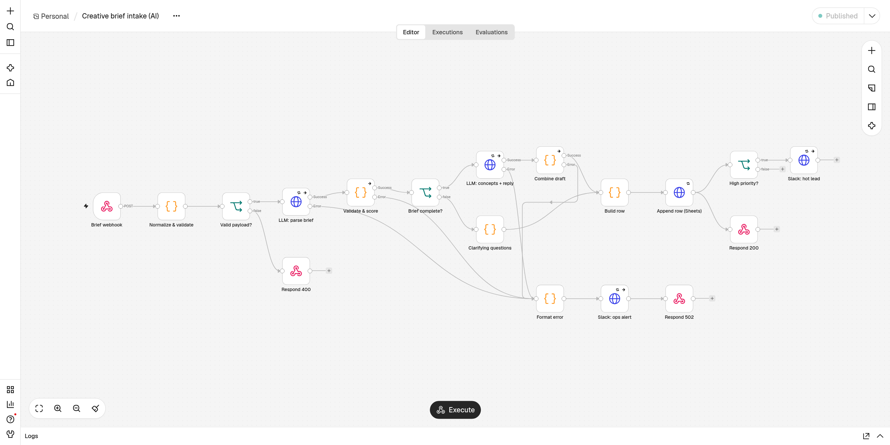
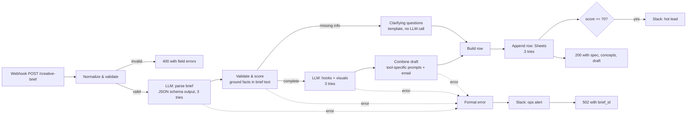
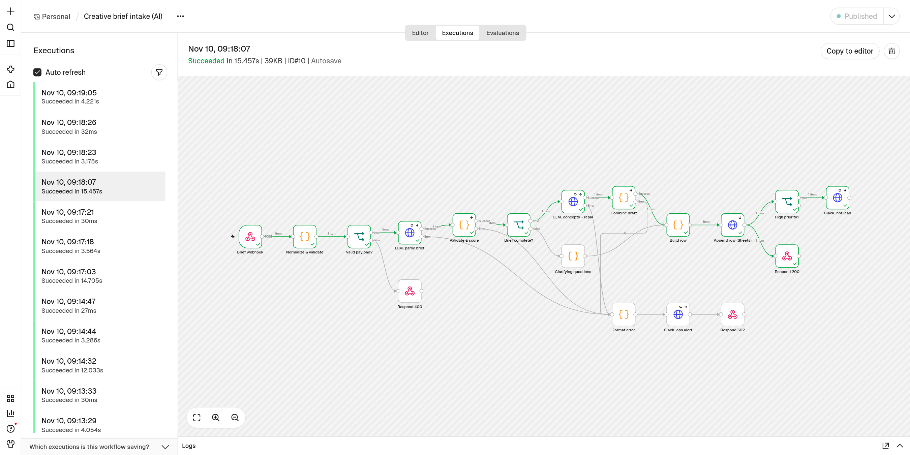

# Creative brief intake for an AI ad agency (n8n)

An n8n workflow that takes a client brief from a website form, turns it into a structured creative spec with an LLM, scores it, and either drafts the next-step email with three concept prompts or asks the client for what is missing. Every brief is logged as a row, hot leads ping Slack, and failures alert ops instead of disappearing.

I built it for the brief stage of an AI creative pipeline: the 30-minute brief, then Midjourney/Kling generation. It ran end to end on n8n 2.47.3 (self-hosted, `npx n8n`) with a local LLM. All the outputs below come from those runs.



## The problem

Inbound briefs arrive as free text: "6 UGC videos for TikTok, $6k, live by March 1" from one client, "can you help us with some AI ads?" from the next. Someone has to read each one, pull out the facts, decide whether it is worth a call, ask for what is missing, and log it. This workflow does that first pass in seconds and leaves a person to review and send.

## How it works



Design choices:

- **The model extracts, code decides.** The LLM fills a JSON schema (Ollama `format` = structured output). A Code node then checks every field against the brief text: a budget must appear in the text, platforms and formats need a keyword match, a deliverable count must be a number the client wrote. Scoring and routing are plain code, so they are predictable and testable.
- **Facts in the email come from the validated spec, not the model.** The second LLM call writes only hooks, scene descriptions and an opening line. Code builds the Midjourney (`--ar 4:5 --style raw`) and Kling prompts from them, with aspect ratios picked per platform, and writes the summary bullets. Any model line containing a number or `$` is dropped, so it can't promise a price or a date.
- **Incomplete briefs skip the second LLM call.** A templated email asks only for the missing fields. This keeps cost down and leaves nothing for the model to make up.
- **Cost tracking.** Each row logs the model, the tokens used and the LLM seconds.

## What's real and what's mocked

| Piece | In this demo | In production |
|---|---|---|
| n8n | Real, self-hosted n8n 2.47.3 | Same, on Docker or a VPS |
| LLM | Real local model: `qwen3:0.6b` on Ollama, CPU only | GPT-4o-mini, Claude Haiku or Gemini Flash |
| Google Sheets | **Mocked**: `mock/mock_services.py` appends to `output/briefs.csv` | Google Sheets node or a CRM (HubSpot, Notion) |
| Slack | **Mocked**: same script appends to `output/slack.jsonl` | Slack incoming webhook |
| Email send | **Not sent.** The draft is returned for a person to review | Gmail draft node, sent by a person |

The 0.6B model was the only one available on the machine. It is good enough to show the structure, and the hooks read like it. Prompt quality goes up a lot with a bigger model, and nothing else in the workflow changes.

## Run it

Requirements: Node 20+, Python 3, [Ollama](https://ollama.com) with `ollama pull qwen3:0.6b`.

```bash
# 1. mock Sheets + Slack on :8099 (FAIL_FIRST=2 makes each endpoint fail twice, to show retries)
python3 mock/mock_services.py 8099 &

# 2. n8n
mkdir n8n-app && cd n8n-app && npm init -y && npm i n8n && cd ..
./scripts.sh reload      # imports workflow/creative-brief-intake.json, publishes it, starts n8n on :5678

# 3. send the sample briefs
./scripts.sh demo
```

Or import `workflow/creative-brief-intake.json` from the n8n editor (Workflows → Import from file). Endpoints, model, schemas and the hot-lead threshold all live in one `CONFIG` block at the top of the **Normalize & validate** node. `workflow/build_workflow.py` generates the JSON, so changes can be reviewed as code.

To use a hosted model, point `llm_url` at an OpenAI-compatible endpoint, add the API key as an n8n credential, and change the two LLM nodes to send `response_format: {type: "json_schema"}` and read `choices[0].message.content`.

## Sample input and output

`samples/complete-brief.json`:

```json
{
  "name": "Priya Raman",
  "email": "priya@linenloom.example",
  "company": "Linen Loom",
  "website": "https://linenloom.example",
  "source": "website-form",
  "brief": "We sell linen shirts and dresses online in the US. We want more sales from Meta and TikTok ads ahead of our spring launch on March 1. Looking for 6 UGC-style videos and 6 static ads, warm natural look, aimed at women 25-40 who care about sustainable fabrics. Budget is about $6,000."
}
```

Parsed and validated spec (`output/response-complete-brief.json`):

```json
{
  "product": "linen shirts and dresses",
  "industry": "women's apparel",
  "goal": "sales",
  "audience": "women 25-40",
  "platforms": [
    "Meta",
    "TikTok"
  ],
  "formats": [
    "ugc_video",
    "static_ad"
  ],
  "deliverable_count": 6,
  "budget_usd": 6000,
  "deadline": "March 1",
  "tone": "warm natural",
  "summary": "sustainable fabrics, women 25-40, US, Meta, TikTok, 6 UGC videos, 6 static ads, $6,000 budget"
}
```

One of the three concepts:

```json
{
  "format": "static_ad",
  "tool": "Midjourney",
  "hook": "Trendy and stylish linen dresses for women 25-40, delivered through Meta and TikTok.",
  "prompt": "A vibrant linen dress with soft colors and natural light, shot in a warm natural setting, warm natural styling, soft natural light, ad-ready composition --ar 4:5 --style raw"
}
```

Draft reply (score 100/100, high priority, so Slack was pinged):

```text
Hi Priya,

Experience the comfort of our sustainable linen fabric in every stitch. Thanks for the Linen Loom brief.

Here is what we have:
- Goal: sales
- Audience: women 25-40
- Formats: UGC-style video and static ad
- Platforms: Meta, TikTok
- Volume: 6 per format
- Live by: March 1

First concept direction: "Experience the comfort of our sustainable linen fabric in every stitch."

Does a 30-minute brief call this week work? Pick any slot and we will bring a creative spec and first variations.

The Kreative Media team
```

The vague brief (`samples/vague-brief.json`, "can you help us out?") scored 0. It got the clarifying-questions email instead. In an earlier run, before I added the grounding checks, the model had filled this brief with "email marketing", "carousel" and "coffee enthusiasts", none of which the client wrote. Now those fields come back empty and get asked about:

```text
Hi Marco,

Thanks for sending the brief for BrewBox. Before we book the brief call, a few quick questions:

1. Which formats do you need: UGC-style video, AI avatar video, static ads, carousels or product photos?
2. Where will the ads run (Meta, TikTok, YouTube Shorts, Google)?
3. Who is the target customer?
4. What budget range do you have in mind for this round?
5. When do you need the first creatives live?
6. Roughly how many final creatives do you want?

Reply here and we will send a creative spec the same day.

The Kreative Media team
```

Rows written (`output/briefs.csv`):

```csv
received_at,brief_id,brand,contact_email,status,completeness,lead_score,priority,formats,missing_fields,prompt_count,reply_subject,model,tokens_used,llm_seconds
2026-11-10T14:18:08.044Z,BR-20261110-A6EBP,Linen Loom,priya@linenloom.example,ready_for_call,100,100,high,"ugc_video, static_ad",,3,Linen Loom brief: next step,qwen3:0.6b,766,7.1
2026-11-10T14:18:23.497Z,BR-20261110-AQSXA,BrewBox,marco@brewbox.example,needs_info,0,0,standard,,"formats, platforms, audience, budget, deadline, deliverable_count",0,A few questions about the BrewBox brief,qwen3:0.6b,265,3.1
```

## Error handling, tested

| Failure | What happens | Evidence |
|---|---|---|
| Bad form payload | 400 listing each bad field, no LLM call | `output/response-invalid.json`: `["company is required", "a valid email is required", "brief must be at least 20 characters"]` |
| Sheets or Slack down | 3 tries, 2 s apart, on every HTTP node | `output/mock-retry-run.log` below |
| LLM down or wrong model | 3 tries, then the error branch: ops alert in Slack, 502 with `brief_id` | `output/response-llm-down.json` |
| LLM returns bad JSON or too few concepts | Code node throws, same error branch | `Validate & score`, `Combine draft` |
| Slack alert itself fails | Logged and skipped, so the client still gets a response | `onError: continueRegularOutput` |

Retry run with `FAIL_FIRST=2`:

```text
[mock] listening on :8099 FAIL_FIRST=2
[mock] /sheets/append call 1: returning 503 (FAIL_FIRST)
[mock] /sheets/append call 2: returning 503 (FAIL_FIRST)
[mock] sheets row: BR-20261110-A6EBP ready_for_call
[mock] /slack/webhook call 1: returning 503 (FAIL_FIRST)
[mock] /slack/webhook call 2: returning 503 (FAIL_FIRST)
[mock] slack: :fire: Linen Loom scored 100/100 (ugc_video, static_ad). Draft reply ready: Line
[mock] sheets row: BR-20261110-AQSXA needs_info
[mock] slack: :rotating_light: Brief BR-20261110-9U8KU (Linen Loom) failed in n8n: 404 - "{\"e
```

Slack messages from the runs (hot lead, then the LLM-down alert):

```text
{"text": ":fire: Linen Loom scored 100/100 (ugc_video, static_ad). Draft reply ready: Linen Loom brief: next step"}
{"text": ":rotating_light: Brief BR-20261110-9U8KU (Linen Loom) failed in n8n: 404 - \"{\\\"error\\\":\\\"model 'model-that-does-not-exist' not found\\\"}\". Lead is safe in the execution log; reply manually."}
```



## What I'd add for a real client

1. Real Sheets/CRM and Slack nodes with stored credentials, plus a Gmail **draft** (not send) so an account manager approves every reply.
2. A separate n8n Error Workflow (Error Trigger) for crashes outside the handled branches, and a dead-letter table for retrying failed briefs.
3. Dedup by email + company within 24 hours, and a Calendly link in the reply.
4. Brand guidelines from Google Drive passed into the concept step (RAG over past winning ads in Qdrant or Supabase).
5. An eval set of 30 real briefs with expected specs, run on every prompt or model change.
6. A per-brief token budget, with a cheaper model for parsing and a stronger one only for concepts.

## Files

```
workflow/creative-brief-intake.json   n8n export (import this)
workflow/build_workflow.py            generates the export
mock/mock_services.py                 local Sheets + Slack stand-in with failure injection
samples/                              complete, vague and invalid briefs
output/                               responses, CSV rows, Slack log, retry log from the runs
docs/                                 screenshots
scripts.sh                            reload + demo helpers
```

MIT licensed. By Antony Vo, [gitlab.com/antonyvo](https://gitlab.com/antonyvo).
